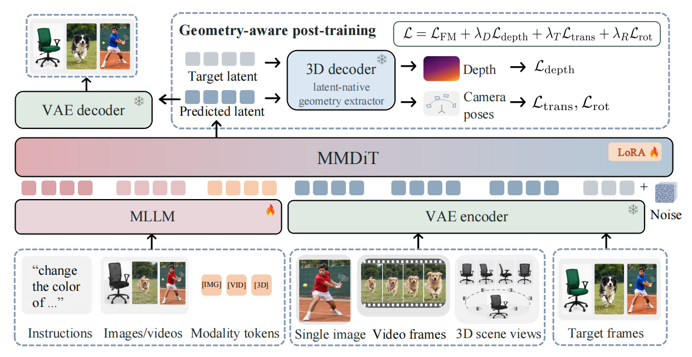
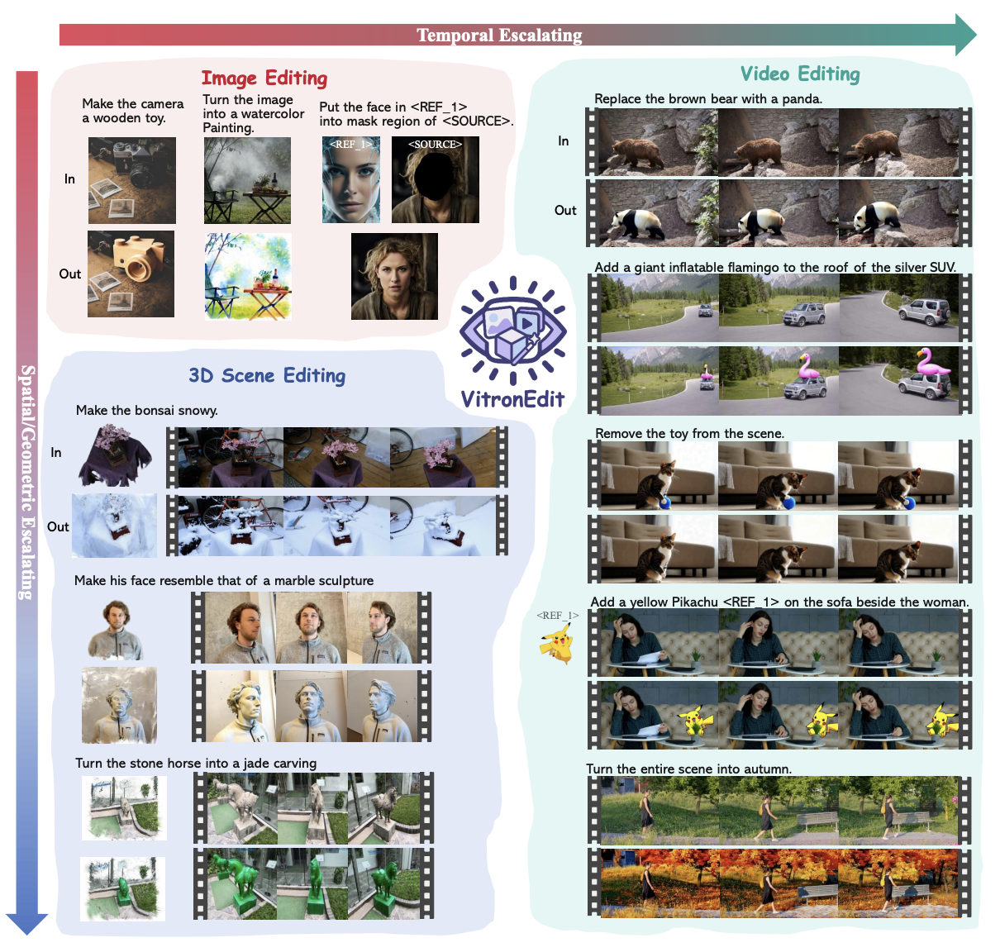

<div align="center">
<h1>VitronEdit: Universal Visual Editing across Images, Videos, and 3D Scenes</h1>
<p>
  Jing Wang<sup>1†</sup> &nbsp;&nbsp; Yanlin Li<sup>1†</sup> &nbsp;&nbsp; Mong-Li Lee<sup>1</sup> &nbsp;&nbsp; Wynne Hsu<sup>1</sup> &nbsp;&nbsp; Shengqiong Wu<sup>2*</sup> &nbsp;&nbsp; Hao Fei<sup>2*</sup>
</p>
<p>
  <sup>1</sup>National University of Singapore &nbsp;&nbsp; <sup>2</sup>University of Oxford
</p>
<p>
  <sup>†</sup>Equal contribution &nbsp;&nbsp; <sup>*</sup>Corresponding author
</p>
</div>

<p align="center">
  <a href="https://arxiv.org/abs/2610.27049"></a>
  <!-- TODO: <a href=""></a> -->
  <a href="https://huggingface.co/SanRiiiii/UniVEdit"></a>
  <a href="https://huggingface.co/datasets/SanRiiiii/UniVEdit_8k"></a>
</p>



UniVEdit is a unified editing model for five tasks:

| Task | Input | Output | Modality token |
|---|---|---|---|
| `i2i` | text + image | edited image | `<T_IMG>` |
| `ti_i2i` | text + image + reference image | edited image | `<T_IMG>` |
| `v2v` | text + video | edited video | `<T_VID>` |
| `tiv2v` | text + video + reference image | edited video | `<T_VID>` |
| `3d23d` | text + multi-view video | edited multi-view video (optionally 3D Gaussians) | `<T_3D>` |

## Visual Results



## Installation

```bash
conda create -n univedit python=3.10 -y && conda activate univedit
pip install torch==2.6.0 torchvision==0.21.0 --index-url https://download.pytorch.org/whl/cu124
pip install -e .
```

For faster attention, install [flash-attn](https://github.com/Dao-AILab/flash-attention/releases):
download the wheel built for your Python, torch and CUDA versions and `pip install` it.

Only needed for the 3D decoder (`--enable_3d_decoder`, geometry post-training):

```bash
bash scripts/setup_vist3a.sh                   # clones VIST3A@32253c3 into third_party/ and applies the patch
export VIST3A_ROOT=$PWD/third_party/VIST3A
pip install --no-deps -r requirements-3d.txt   # see the file header for torch_scatter
```

## 1. Inference

### 1.1 Weights

1. Base model: [OmniWeaving](https://github.com/Tencent-Hunyuan/OmniWeaving) with its
   text and vision encoders, downloaded to `ckpts/omniweaving` by its
   [instructions](https://github.com/Tencent-Hunyuan/OmniWeaving/blob/main/download-checkpoint.md).
2. UniVEdit checkpoint (`geo3d/`: LoRA and modality tokens) and the stitched 3D
   decoder (`3d_decoder/stitched_model.pth`), from
   [SanRiiiii/UniVEdit](https://huggingface.co/SanRiiiii/UniVEdit):
   `hf download SanRiiiii/UniVEdit --local-dir ckpts/univedit`
3. For 3D export and geometry post-training: AnySplat
   (`hf download lhjiang/anysplat --local-dir ckpts/anysplat`).

### 1.2 Inputs

The inputs are jsonl files with one sample per line: one file for images
(`i2i`, `ti_i2i`), one for videos (`v2v`, `tiv2v`) and one for 3D scenes
(`3d23d`). [examples/inference/](examples/inference/) has an example of each.

```json
{"id": "add", "source": "images/house.jpg", "text": "include a person walking down the street"}
{"id": "reference", "source": "images/dog.jpg", "reference": "references/dragon.jpg", "text": "change the dog to a [V*]"}
```

### 1.3 Run

```bash
MODEL_PATH=ckpts/omniweaving CHECKPOINT_PATH=ckpts/univedit/geo3d \
IMAGE_METADATA=examples/inference/image_metadata.jsonl \
VIDEO_METADATA=examples/inference/video_metadata.jsonl \
THREED_METADATA=examples/inference/threed_metadata.jsonl \
OUTPUT_DIR=outputs/univedit_batch \
bash scripts/infer/batch.sh
```

The results are written to `OUTPUT_DIR/<task>/`. Append `--enable_3d_decoder true`
to also export 3D Gaussians for `3d23d`.

## 2. Training

### 2.1 Data

A dataset is a directory, local or in a Hugging Face dataset repo
(`hf://datasets/<user>/<repo>[/<subdir>]`), in one of two forms.

**Manifest**: a `metadata.jsonl` file with one sample per line, its paths
relative to the directory:

```
data/my_i2i/
  metadata.jsonl
  images/0001_source.jpg
  images/0001_target.jpg
```

```json
{"source": "images/0001_source.jpg", "target": "images/0001_target.jpg", "text": "make the sky pink"}
```

**Shards**: tar files in WebDataset layout, where the members `<key>.<field>` of
one key form a sample (`0001.source.jpg`, `0001.target.jpg`, `0001.txt`), or
parquet files with the same fields.

`source` and `target` are images for `i2i` / `ti_i2i` and videos for `v2v` /
`tiv2v` / `3d23d` (a video file, or in a manifest also a directory of frame
images); `ti_i2i` and `tiv2v` samples also have a `reference` image.

The datasets are listed in a YAML data config, grouped by modality (`image`,
`video`, `3d`). The name of a dataset is shown in the training logs; every
optimizer update samples one dataset with probability `prob` / (sum of all `prob`):

```yaml
image:
  datasets:
    my_i2i:    {task: i2i,    path: data/my_i2i,    prob: 0.2}
    my_ti_i2i: {task: ti_i2i, path: data/my_ti_i2i, prob: 0.2}
video:
  num_frames: 65
  datasets:
    my_v2v:    {task: v2v,   path: data/my_v2v,   prob: 0.2}
    my_tiv2v:  {task: tiv2v, path: data/my_tiv2v, prob: 0.2}
3d:
  num_views: 26
  datasets:
    my_3d:     {path: data/my_3d, prob: 0.2}
```

Options set above `datasets` are defaults for the datasets of the group; a
dataset may set its own value.

| Option | Set for | Meaning |
|---|---|---|
| `task` | dataset | `i2i` / `ti_i2i` in `image`, `v2v` / `tiv2v` in `video`, `3d23d` in `3d` (the default there) |
| `path` | dataset | Local directory or `hf://datasets/<user>/<repo>[/<subdir>]` |
| `prob` | dataset | Sampling weight (default 1) |
| `format` | dataset | Which form the directory holds. `auto` (default) decides from its files: a `metadata.jsonl` at the top of the directory is read as the manifest, unless `shards` is set; otherwise every tar file, or every parquet file, below the directory is read as shards (finding both is an error). `jsonl`, `tar` or `parquet` sets the form, e.g. to read the tar files of a directory that also has a `metadata.jsonl`. |
| `shards` | dataset | Glob of the shard files below the directory (`*` within a directory, `**` across directories). Default: every file of the format, `**/*.tar` or `**/*.parquet`. |
| `keys` | dataset | Field names of the dataset, needed only where they differ from the defaults: `source`, `target` and `reference` (also found with an extension, such as `source.jpg`), and `txt`, `text` or `json.text` for the instruction. A dotted name reads a field of a JSON entry, such as `json.edit_instruction`. |
| `num_frames` | `video` | Frames per clip, 4n+1 (default 65) |
| `frame_sampling` | `video` | Which `num_frames` frames are taken from a longer video: `random_clip` (default) or `center_clip`, consecutive frames at a random or the middle position; `first`, the first frames; `uniform`, frames spread over the whole video. A video of at most `num_frames` frames gives all its frames, padded with its last frame. |
| `num_views` | `3d` | Views K per sample (default 26), read as 4(K-1)+1 frames: the first view once, every other view 4 times |
| `view_window` | `3d` | How many consecutive frames of the source video the K views are taken from, evenly spaced, at a random position (a shorter video gives all its frames). It does not change the frames read per sample, only how far apart the views are, i.e. how much the camera moves between them. Default 4(K-1)+1: every 4th frame becomes a view. |

For example, tar shards under `data/` whose members are `<key>.source.jpg`,
`<key>.edited.jpg`, `<key>.ref.jpg` and `<key>.json` with the instruction under
`text` (the source and the instruction match the defaults):

```yaml
    my_ti_i2i:
      task: ti_i2i
      path: hf://datasets/<user>/<repo>
      format: tar
      shards: "data/*.tar"
      keys: {target: edited.jpg, reference: ref.jpg}
```

[configs/data.example.yaml](configs/data.example.yaml) and
[configs/data.geo.example.yaml](configs/data.geo.example.yaml) hold the task mix
of our two training stages: copy them to `configs/data.yaml` and
`configs/data.geo.yaml` and set the paths.

### 2.2 Multi-task fine-tuning

```bash
MODEL_PATH=ckpts/omniweaving \
DATA_CONFIG=configs/data.yaml \
OUTPUT_DIR=outputs/univedit_multitask \
bash scripts/train/multitask.sh
```

The script holds the settings of our run on 8 GPUs, among them the batch size and
gradient accumulation of each group: `--dataloader_batch_sizes image:10,video:5,3d:3`
and `--dataloader_gradient_accumulation_steps image:6,video:3,3d:5` (a dataset
name in place of a group sets one dataset; datasets not listed use `--batch_size`
and `--gradient_accumulation_steps`). Arguments after the script override these.
Set `RESUME_FROM_CHECKPOINT=<checkpoint dir>` to continue a run.

### 2.3 Geometry post-training

```bash
MODEL_PATH=ckpts/omniweaving \
DATA_CONFIG=configs/data.geo.yaml \
OUTPUT_DIR=outputs/univedit_geo \
INIT_CHECKPOINT=outputs/univedit_multitask/checkpoint-N \
DECODER_CKPT=ckpts/univedit/3d_decoder/stitched_model.pth \
ANYSPLAT_PATH=ckpts/anysplat \
VIST3A_ROOT=third_party/VIST3A \
bash scripts/train/geo_posttrain.sh
```

This stage continues from a multi-task checkpoint with depth and camera-pose
losses from the 3D decoder. Its 3D samples have 17 views (65 frames), the frames
that `--geo_extractor_max_frames 17 --geo_frame_stride 4` of the script pass to
these losses; change `num_views` and the two arguments together.

## License

The code under `src/hyvideo/` and the released weights are derived from Tencent
HY-OmniWeaving and are distributed under the **Tencent HY Community License
Agreement** ([License.txt](License.txt), [Notice.txt](Notice.txt)).

## Acknowledgements

This work builds on [OmniWeaving](https://github.com/Tencent-Hunyuan/OmniWeaving),
[HunyuanVideo-1.5](https://github.com/Tencent-Hunyuan/HunyuanVideo-1.5),
[VIST3A](https://github.com/gohyojun15/VIST3A),
[AnySplat](https://github.com/InternRobotics/AnySplat) and
[Qwen2.5-VL](https://github.com/QwenLM/Qwen2.5-VL).
