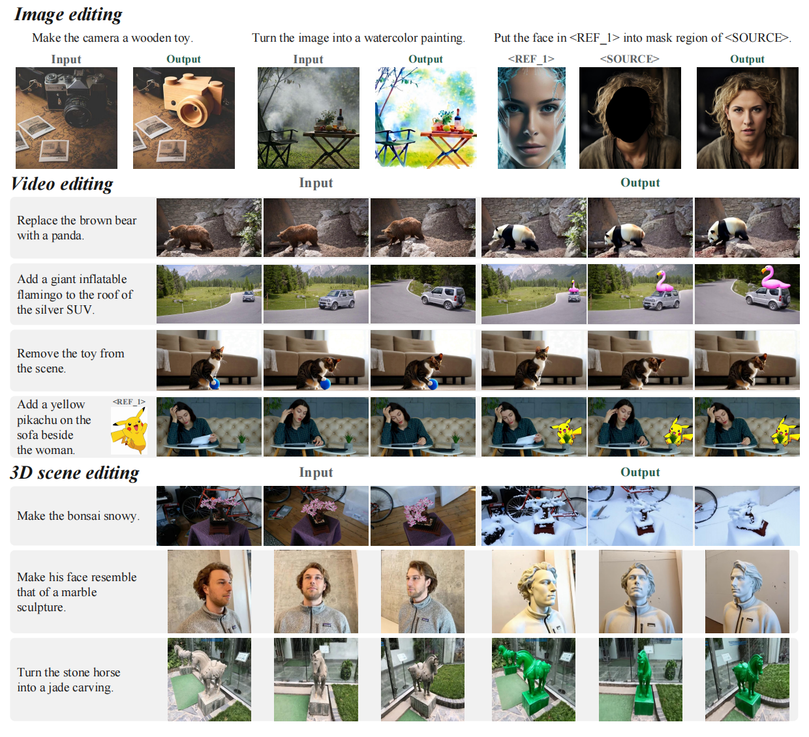

<div align="center">
<h1>VitronEdit: Universal Visual Editing across Images, Videos, and 3D Scenes</h1>
<p>
  Jing Wang<sup>1</sup> &nbsp;&nbsp; Yanlin Li<sup>1</sup> &nbsp;&nbsp; Mong-Li Lee<sup>1</sup> &nbsp;&nbsp; Wynne Hsu<sup>1</sup> &nbsp;&nbsp; Shengqiong Wu<sup>2</sup> &nbsp;&nbsp; Hao Fei<sup>2</sup>
</p>
<p>
  <sup>1</sup>National University of Singapore &nbsp;&nbsp; <sup>2</sup>University of Oxford
</p>
</div>

<p align="center">
  <a href=""></a>
  <!-- TODO: <a href=""></a> -->
  <a href="https://huggingface.co/SanRiiiii/UniVEdit"></a>
  <a href="https://huggingface.co/datasets/SanRiiiii/UniVEdit_8k"></a>
</p>


UniVEdit is a unified editing model for five tasks:

| Task | Input | Output | Modality token |
|---|---|---|---|
| `i2i` | text + image | edited image | `<T_IMG>` |
| `ti_i2i` | text + image + reference image | edited image | `<T_IMG>` |
| `v2v` | text + video | edited video | `<T_VID>` |
| `tiv2v` | text + video + reference image | edited video | `<T_VID>` |
| `3d23d` | text + multi-view video | edited multi-view video (optionally 3D Gaussians) | `<T_3D>` |

## Visual Results



## Installation

```bash
conda create -n univedit python=3.10 -y && conda activate univedit
pip install torch==2.6.0 torchvision==0.21.0 --index-url https://download.pytorch.org/whl/cu124
pip install -e .
```

For faster attention, install [flash-attn](https://github.com/Dao-AILab/flash-attention/releases):
download the wheel built for your Python, torch and CUDA versions and `pip install` it.

Only needed for the 3D decoder (`--enable_3d_decoder`, geometry post-training):

```bash
bash scripts/setup_vist3a.sh                   # clones VIST3A@32253c3 into third_party/ and applies the patch
export VIST3A_ROOT=$PWD/third_party/VIST3A
pip install --no-deps -r requirements-3d.txt   # see the file header for torch_scatter
```

## 1. Inference

### 1.1 Weights

1. Base model: [OmniWeaving](https://github.com/Tencent-Hunyuan/OmniWeaving) with its
   text and vision encoders, downloaded to `ckpts/omniweaving` by its
   [instructions](https://github.com/Tencent-Hunyuan/OmniWeaving/blob/main/download-checkpoint.md).
2. UniVEdit checkpoint (`geo3d/`: LoRA and modality tokens) and the stitched 3D
   decoder (`3d_decoder/stitched_model.pth`), from
   [SanRiiiii/UniVEdit](https://huggingface.co/SanRiiiii/UniVEdit):
   `hf download SanRiiiii/UniVEdit --local-dir ckpts/univedit`
3. For 3D export and geometry post-training: AnySplat
   (`hf download lhjiang/anysplat --local-dir ckpts/anysplat`).

### 1.2 Inputs

The inputs are jsonl files with one sample per line: one file for images
(`i2i`, `ti_i2i`), one for videos (`v2v`, `tiv2v`) and one for 3D scenes
(`3d23d`). [examples/inference/](examples/inference/) has an example of each.

```json
{"id": "add", "source": "images/house.jpg", "text": "include a person walking down the street"}
{"id": "reference", "source": "images/dog.jpg", "reference": "references/dragon.jpg", "text": "change the dog to a [V*]"}
```

### 1.3 Run

```bash
MODEL_PATH=ckpts/omniweaving CHECKPOINT_PATH=ckpts/univedit/geo3d \
IMAGE_METADATA=examples/inference/image_metadata.jsonl \
VIDEO_METADATA=examples/inference/video_metadata.jsonl \
THREED_METADATA=examples/inference/threed_metadata.jsonl \
OUTPUT_DIR=outputs/univedit_batch \
bash scripts/infer/batch.sh
```

The results are written to `OUTPUT_DIR/<task>/`. Append `--enable_3d_decoder true`
to also export 3D Gaussians for `3d23d`.

## 2. Training

### 2.1 Data

A dataset is a directory with a `metadata.jsonl` manifest and its media files:

```
data/my_i2i/
  metadata.jsonl
  images/0001_source.jpg
  images/0001_target.jpg
```

```json
{"source": "images/0001_source.jpg", "target": "images/0001_target.jpg", "text": "make the sky pink"}
```

`source` and `target` are images for `i2i` / `ti_i2i` and videos for `v2v` /
`tiv2v` / `3d23d`; `ti_i2i` and `tiv2v` samples also have a `reference` image.
Tar shards (WebDataset layout) and parquet shards with the same fields are read
too, from a local directory or a Hugging Face dataset repo
(`hf://datasets/<user>/<repo>`).

The datasets are listed in a YAML data config, grouped by modality, with the
batch settings of each group and the sampling weight (`prob`) of each dataset:

```yaml
image:
  batch_size: 10                     # per GPU
  gradient_accumulation_steps: 6
  datasets:
    my_i2i:    {task: i2i,    path: data/my_i2i,    prob: 0.2}
    my_ti_i2i: {task: ti_i2i, path: data/my_ti_i2i, prob: 0.2}
video:
  batch_size: 5
  gradient_accumulation_steps: 3
  datasets:
    my_v2v:    {task: v2v,   path: data/my_v2v,   prob: 0.2}
    my_tiv2v:  {task: tiv2v, path: data/my_tiv2v, prob: 0.2}
3d:
  batch_size: 3
  gradient_accumulation_steps: 5
  datasets:
    my_3d:     {path: data/my_3d, prob: 0.2}
```

[configs/data.example.yaml](configs/data.example.yaml) is the config of multi-task
fine-tuning with every option commented, and
[configs/data.geo.example.yaml](configs/data.geo.example.yaml) the one of geometry
post-training.

### 2.2 Multi-task fine-tuning

```bash
MODEL_PATH=ckpts/omniweaving \
DATA_CONFIG=configs/data.yaml \
OUTPUT_DIR=outputs/univedit_multitask \
bash scripts/train/multitask.sh
```

The script holds the settings of our run on 8 GPUs. Set
`RESUME_FROM_CHECKPOINT=<checkpoint dir>` to continue a run.

### 2.3 Geometry post-training

```bash
MODEL_PATH=ckpts/omniweaving \
DATA_CONFIG=configs/data.geo.yaml \
OUTPUT_DIR=outputs/univedit_geo \
INIT_CHECKPOINT=outputs/univedit_multitask/checkpoint-N \
DECODER_CKPT=ckpts/univedit/3d_decoder/stitched_model.pth \
ANYSPLAT_PATH=ckpts/anysplat \
VIST3A_ROOT=third_party/VIST3A \
bash scripts/train/geo_posttrain.sh
```

This stage continues from a multi-task checkpoint with depth and camera-pose
losses from the 3D decoder.

## License

The code under `src/hyvideo/` and the released weights are derived from Tencent
HY-OmniWeaving and are distributed under the **Tencent HY Community License
Agreement** ([License.txt](License.txt), [Notice.txt](Notice.txt)).

## Acknowledgements

This work builds on [OmniWeaving](https://github.com/Tencent-Hunyuan/OmniWeaving),
[HunyuanVideo-1.5](https://github.com/Tencent-Hunyuan/HunyuanVideo-1.5),
[VIST3A](https://github.com/gohyojun15/VIST3A),
[AnySplat](https://github.com/InternRobotics/AnySplat) and
[Qwen2.5-VL](https://github.com/QwenLM/Qwen2.5-VL).
